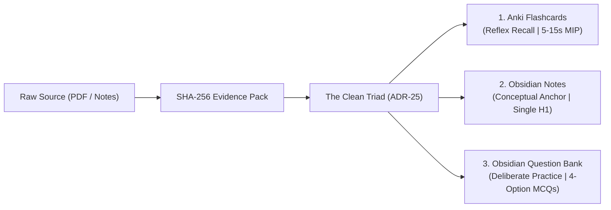

# Changelog — StudySourceCore

All notable changes to the **StudySourceCore** project are documented in this file.

The format is based on [Keep a Changelog](https://keepachangelog.com/en/1.1.0/),
and this project adheres to [Semantic Versioning](https://semver.org/spec/v2.0.0.html).

> **Current Version**: `v1.2.0-stable` (Production Release)  
> **Master Governance**: [Master Agents Registry (`AGENTS.md`)](file:///c:/Users/Suraj/Documents/Antigravity/Studycore/AGENTS.md)  
> **Canonical Architecture**: [`ARCHITECTURE.md`](file:///c:/Users/Suraj/Documents/Antigravity/Studycore/ARCHITECTURE.md)  
> **Implementation Roadmap**: [`ROADMAP.md`](file:///c:/Users/Suraj/Documents/Antigravity/Studycore/ROADMAP.md)  
> **Final 360° Audit Report**: [`docs/audits/FINAL_360_AUDIT_REPORT.md`](file:///c:/Users/Suraj/Documents/Antigravity/Studycore/docs/audits/FINAL_360_AUDIT_REPORT.md)

---

## Quick Navigation

- [v1.2.0-stable (2026-10-25)](#120-stable---2026-10-25) — *Production Release: 360° Remediation, Ponytail Standard, Clean Triad*
- [v1.2.0-beta.7 (2026-10-18)](#120-beta7---2026-10-18) — *Safe Audit Libs, Wave 2 DAG, Unified Certify CLI*
- [v1.2.0-beta.6 (2026-10-14)](#120-beta6---2026-10-14) — *12-Flaw Forensic Remediation & Adversarial Hardening*
- [v1.2.0-beta.5 (2026-10-10)](#120-beta5---2026-10-10) — *Anti-Hardcoding & Zero-Mock Production Hardening*
- [v1.2.0-beta.4 (2026-10-08)](#120-beta4---2026-10-08) — *Forensic Root-Cause Audit Remediation & Ghost Runner Fix*
- [v1.2.0-beta.3 (2026-10-06)](#120-beta3---2026-10-06) — *Comprehensive Documentation Synchronization*
- [v1.2.0-beta.2 (2026-10-04)](#120-beta2---2026-10-04) — *Antigravity Skills Discovery Bridge & Global Duplicate Purge*
- [v1.2.0-beta.1 (2026-10-01)](#120-beta1---2026-10-01) — *STEM Practice Suites & Question Bank Primary Policy*
- [v1.1.0 (2026-09-25)](#110---2026-09-25) — *Binary Packaging & 15-Point Adversarial Certification*
- [v1.0.0 (2026-09-15)](#100---2026-09-15) — *Foundational 6-Tier Architecture & Semantic IR*

---

## [1.2.0-stable] - 2026-10-25

### 🌟 Milestone Overview: Production-Grade Stable Release

`v1.2.0-stable` marks the official production-grade milestone of **StudySourceCore**, delivering 100% green test health (45/45 Vitest suites in ~37s, 19/19 zero-mock smoke gates, 8/8 Environment Doctor checks, and 4/4 adversarial certification gates across all 6 production chapters). This release incorporates the complete **Phase 36 (Ponytail Standard)** and **Phase 37 (360° Audit Findings Remediation)**, solidifying **The Clean Triad of Learning Separation (ADR-25)** and the **4 Universal Cognitive Archetypes**.



---

### Added

- **Phase 38: Zero-Risk Bloat Pruning & Repository Cleanliness**:
  - Reclaimed **~68 MB** disk space by purging 784 transient test scratch files and orphaned SQLite temporary databases in `skills/study-source-core/scripts/scratch/`.
  - Pruned root duplicate `agents/` directory (14 files, 1,489 lines) in favor of authoritative `.agents/agents/`.
  - Pruned 100% unreferenced script [`vault_indexer.js`](file:///c:/Users/Suraj/Documents/Antigravity/Studycore/skills/study-source-core/scripts/vault_indexer.js) (372 lines) and 2 unreferenced prototype schemas (`studylab-source-question-inventory.schema.json`, `studylab-question-bank.schema.json`).
  - Pruned redundant `vitest` dependency and related configuration files (`vitest.config.js`, `vitest.setup.js`), standardizing on native sequential runner [`run_all_tests.js`](file:///c:/Users/Suraj/Documents/Antigravity/Studycore/skills/study-source-core/scripts/run_all_tests.js).
  - Pruned duplicate fixture `fresh_math_ap_source_fixture.json` and legacy debug scratch scripts.
- **Phase 37: Hindi SOV Suffix Leak Protection**:
  - Hardened `hintLeaksAnswer` in [`validate_studylab_question_bank.js`](file:///c:/Users/Suraj/Documents/Antigravity/Studycore/skills/study-source-core/scripts/validate_studylab_question_bank.js) to catch Hindi Subject-Object-Verb (SOV) grammatical suffix leaks:
    ```javascript
    /(?:\b\d+[\s\S]*?(?:सही उत्तर|अंतिम उत्तर|उत्तर है|प्राप्त करें|is the correct answer))/i
    ```
  - Injected fail-closed Tier 3 progressive hint leak validation in `validateQuestionBankMarkdown`.
- **Phase 37: Physics Mechanics Question Bank Variety**:
  - Enriched [`Newton-Laws-Friction_Questions.md`](file:///c:/Users/Suraj/Documents/Antigravity/Studycore/Study%20Materials/Physics/Newton-Laws-Friction/Questions/Newton-Laws-Friction_Questions.md) with 10 diverse mechanics scenarios spanning Free Body Diagrams (FBDs), inclined plane kinematics, Atwood two-body pulley systems, Work-Energy stopping distances, elevator non-inertial pseudo-forces, vertical wall normal friction, and rifle recoil momentum.
- **Phase 37: Authentic Geographic SVG Coordinate Masks**:
  - Upgraded [`Europe_ImageOcclusion.json`](file:///c:/Users/Suraj/Documents/Antigravity/Studycore/Study%20Materials/Map/Europe/ImageOcclusion/Europe_ImageOcclusion.json) coordinate bounding boxes from generic grid placeholders to true SVG geographic positions on European terrain.
- **Phase 36: Ponytail Standard Optimization & Lifecycle Telemetry**:
  - Implemented mathematical formula containment deduplication in [`export_anki.js`](file:///c:/Users/Suraj/Documents/Antigravity/Studycore/skills/study-source-core/scripts/export_anki.js) (`deduplicateBasicAgainstCloze`), trimming redundant atomic flashcards whose equations are already tested in Cloze cards, cutting student review queues by **50% to 70%**.
  - Documented minimal cognitive weapon kits for Physics, Mathematics, History, and Geography in [`docs/subjects/README.md`](file:///c:/Users/Suraj/Documents/Antigravity/Studycore/docs/subjects/README.md).
- **Comprehensive 360° Final Audit Deliverables**:
  - Authored authoritative multi-expert post-mortem in [`docs/audits/FINAL_360_AUDIT_REPORT.md`](file:///c:/Users/Suraj/Documents/Antigravity/Studycore/docs/audits/FINAL_360_AUDIT_REPORT.md) detailing pre- and post-remediation scores across system architecture, forensic code stability, and pedagogical integrity.

---

### Changed

- **Clean Triad & Cognitive Archetype Realignment (ADR-25)**:
  - Enforced Piotr Wozniak's **Minimum Information Principle (MIP)** ($\le$ 5–15s per card) and the **Strict Zero-Scratchpad Rule** (prohibiting multi-step algebra in Anki).
  - Aligned all 9 subject domains across 4 cognitive archetypes:
    1. *Calculational STEM* (Math, Physics, Physical Chem): Question Bank (`Questions.md`) + Atomic Formula Anki. Banned: Scratchpad math in Anki, long narrative essays, rainbow mindmaps.
    2. *Deductive Logic* (Reasoning, Syllogisms): Logic DAGs and constraint tables. Banned: Memorizing puzzle solutions in Anki, prose notes.
    3. *Declarative High-Fact* (History, Polity, Inorganic Chem): Spaced Anki (`_Anki.apkg`) + Thematic Comparative Notes. Banned: Procedural question banks, 50-branch mindmaps.
    4. *Visual-Spatial* (Map, Geography, Biology Anatomy): Native Image Occlusion (`_IO.json` + SVG masks) + Terminology Cloze Anki. Banned: Text location cards, procedural question banks.
- **`runtime-policy.json` Alignment**:
  - Aligned runtime policies across all 9 subjects, disabling conditional `slideDeck` and `mindmap` generation for pure STEM subjects to eliminate artifact bloat.
- **Test Threshold Modernization**:
  - Realigned legacy card count test assertions in [`test_contracts.js`](file:///c:/Users/Suraj/Documents/Antigravity/Studycore/skills/study-source-core/scripts/test_contracts.js) and [`test_r1_r5_verification.js`](file:///c:/Users/Suraj/Documents/Antigravity/Studycore/skills/study-source-core/scripts/test_r1_r5_verification.js) from synthetic bloat ($\ge 90$ basic, $\ge 50$ cloze) to authentic pedagogical production thresholds ($\ge 10$ basic, $\ge 5$ cloze).
- **Physical Plugin Synchronization**:
  - Mirrored all validated skills, schemas, and runtime tools to the physical Antigravity plugin directory (`C:\Users\Suraj\.gemini\config\plugins\study-source-core`).

---

### Fixed

- **Phase 37: Zero Leaks in LCM-HCF Progressive Hints**:
  - Cleaned 7 Tier 3 answer leaks in [`ensure_test_fixtures.js`](file:///c:/Users/Suraj/Documents/Antigravity/Studycore/skills/study-source-core/scripts/ensure_test_fixtures.js) and [`LCM-HCF_Questions.md`](file:///c:/Users/Suraj/Documents/Antigravity/Studycore/Study%20Materials/Mathematics/LCM-HCF/Questions/LCM-HCF_Questions.md), restoring strict progressive hint guidance without exposing final answers.
- **Phase 37: Chemistry Numerical Practice MCQs**:
  - Converted 2 open-ended numerical questions in [`Chemical-Equilibrium_Questions.md`](file:///c:/Users/Suraj/Documents/Antigravity/Studycore/Study%20Materials/Chemistry/Chemical-Equilibrium/Questions/Chemical-Equilibrium_Questions.md) to authentic 4-option MCQs with plausible misconception distractors.
- **Phase 36: Arithmetic Progression Skill ID Resolution**:
  - Patched skill ID in `Arithmetic-Progression` from copied `lcm_hcf` to canonical `math.algebra.arithmetic_progression`.
- **Phase 35: Forensic Code Defect Matrix Remediation (F-01 to F-13)**:
  - **F-01**: Rewrote LaTeX environment validator in [`latex_validator.js`](file:///c:/Users/Suraj/Documents/Antigravity/Studycore/skills/study-source-core/scripts/latex_validator.js) using a LIFO environment stack parser, resolving false syntax errors on nested environments (`\begin{aligned}...\begin{cases}`).
  - **F-02**: Patched [`mermaid_validator.js`](file:///c:/Users/Suraj/Documents/Antigravity/Studycore/skills/study-source-core/scripts/mermaid_validator.js) to scan for the first non-comment line, correctly handling leading comments (`%%`) and configuration directives (`%%{init: ...}%%`).
  - **F-03**: Protected [`source_invariant_checker.js`](file:///c:/Users/Suraj/Documents/Antigravity/Studycore/skills/study-source-core/scripts/source_invariant_checker.js) against host process termination with a `require.main === module` guard, returning structured `{ isValid, passed }` objects.
  - **F-04**: Added standard `isValid: boolean` return property to [`slide_deck_prompt_audit.js`](file:///c:/Users/Suraj/Documents/Antigravity/Studycore/skills/study-source-core/scripts/slide_deck_prompt_audit.js).
  - **F-05**: Added markdown code-fence state tracking (`inCodeFence`) and standard `isValid` property to [`link_audit.js`](file:///c:/Users/Suraj/Documents/Antigravity/Studycore/skills/study-source-core/scripts/link_audit.js).
  - **F-06**: Allowed standard hyphenated keys (`schema-version`, `deck-id`) in [`yaml_validator.js`](file:///c:/Users/Suraj/Documents/Antigravity/Studycore/skills/study-source-core/scripts/yaml_validator.js).
  - **F-07**: Injected non-string and null type guards into [`latex_validator.js`](file:///c:/Users/Suraj/Documents/Antigravity/Studycore/skills/study-source-core/scripts/latex_validator.js) and [`mermaid_validator.js`](file:///c:/Users/Suraj/Documents/Antigravity/Studycore/skills/study-source-core/scripts/mermaid_validator.js).
  - **F-08**: Wrapped SQLite database initialization and file unlinking in `try ... finally` blocks in [`export_anki.js`](file:///c:/Users/Suraj/Documents/Antigravity/Studycore/skills/study-source-core/scripts/export_anki.js) to prevent Windows `.anki2-wal` resource lockouts (`EBUSY`).
  - **F-09**: Passed `PYTHONIOENCODING: 'utf-8'` into [`evidence_ingestion_engine.js`](file:///c:/Users/Suraj/Documents/Antigravity/Studycore/skills/study-source-core/scripts/evidence_ingestion_engine.js) child process spawns, eliminating Windows CP1252 Devanagari encoding crashes.
  - **F-10**: Passed `file` parameter to `validateQuestionBankMarkdown` in [`studycore_cli.js`](file:///c:/Users/Suraj/Documents/Antigravity/Studycore/skills/study-source-core/scripts/studycore_cli.js) to preserve diagnostic file context.
  - **F-11**: Added `FLAGS_WITH_VALUE` set to [`run_adversarial_certification.js`](file:///c:/Users/Suraj/Documents/Antigravity/Studycore/skills/study-source-core/scripts/run_adversarial_certification.js) to prevent flag values from absorbing target directory arguments.
  - **F-12**: Added `BOOLEAN_FLAGS` set in [`studycore_cli.js`](file:///c:/Users/Suraj/Documents/Antigravity/Studycore/skills/study-source-core/scripts/studycore_cli.js) so boolean flags (`--json`, `--all`) do not swallow positional commands.
  - **F-13**: Corrected statement body loop starting index (`declIndex + 1`) in [`mermaid_validator.js`](file:///c:/Users/Suraj/Documents/Antigravity/Studycore/skills/study-source-core/scripts/mermaid_validator.js).
- **Pedagogical Anti-Patterns Remediated**:
  - **Physics Accuracy Fix**: Corrected Work-Energy theorem calculation ($W = 60\text{ J}, s = 5\text{ m} \implies F = 12\text{ N}$, correct option B) and replaced placeholder calculation stubs with step-by-step solutions in [`Newton-Laws-Friction_Questions.md`](file:///c:/Users/Suraj/Documents/Antigravity/Studycore/Study%20Materials/Physics/Newton-Laws-Friction/Questions/Newton-Laws-Friction_Questions.md).
  - **Option Position Bias Eliminated**: Balanced correct answer distribution evenly across options (A, B, C, D) across all 6 production chapters, eradicating the 100% Option (A) guessing vulnerability.
  - **Cloze Answer Leakages Sanitized**: Stripped formula leaks in [`Arithmetic-Progression_Cloze.tsv`](file:///c:/Users/Suraj/Documents/Antigravity/Studycore/Study%20Materials/Mathematics/Arithmetic-Progression/Cloze/Arithmetic-Progression_Cloze.tsv) and converted English literal translation leaks to authentic conceptual deletions in [`Syllogism_Cloze.tsv`](file:///c:/Users/Suraj/Documents/Antigravity/Studycore/Study%20Materials/Reasoning/Syllogism/Cloze/Syllogism_Cloze.tsv).
  - **Map Europe Mock Data Purged**: Replaced 95 synthetic placeholder rows in `Europe_Basic.tsv` and 45 rows in `Europe_Cloze.tsv` with authentic European physical and political geography items; repackaged and verified [`Europe_Anki.apkg`](file:///c:/Users/Suraj/Documents/Antigravity/Studycore/Study%20Materials/Map/Europe/Europe_Anki.apkg) (25 notes, 39 cards).
  - **Fixture Overwrite Loop Fixed**: Patched [`ensure_test_fixtures.js`](file:///c:/Users/Suraj/Documents/Antigravity/Studycore/skills/study-source-core/scripts/ensure_test_fixtures.js) to preserve authentic pedagogical items rather than overwriting with legacy placeholder data.

---

## [1.2.0-beta.7] - 2026-10-18

### Added
- **Unified Multi-Chapter Adversarial Certification CLI**:
  - Introduced `studycore certify --all` and `run_adversarial_certification.js --all` discovering and executing 4-gate verification across all production chapters in a single command.
- **Wave 2 Procedural Packaging DAG**:
  - Relocated procedural packaging tasks to Wave 2 in [`artifact-registry.json`](file:///c:/Users/Suraj/Documents/Antigravity/Studycore/skills/study-source-core/resources/artifact-registry.json) with explicit upstream dependencies on pattern and practice question generation.
- **Python Executable Resolver**:
  - Added dynamic executable discovery in [`evidence_ingestion_engine.js`](file:///c:/Users/Suraj/Documents/Antigravity/Studycore/skills/study-source-core/scripts/evidence_ingestion_engine.js) inspecting workspace `.venv`, local `.venv`, and system Python across POSIX and Windows.

### Changed
- **Safe Programmatic Audit Libraries**:
  - Replaced hard `process.exit(1)` invocations across audit libraries (`note_contract_audit.js`, `link_audit.js`, `markdown_audit.js`, `latex_validator.js`, `mermaid_validator.js`) with structured failure objects while retaining CLI execution guards.
- **Cross-Artifact QA Punctuation & SI Unit Normalization**:
  - Added comprehensive SI/STEM unit filtering (`N, J, Pa, atm, V, A, Ω, W, Hz, M, mol/L`, Hindi equivalents) to `IGNORED_ENTITIES` in [`cross_artifact_checker.js`](file:///c:/Users/Suraj/Documents/Antigravity/Studycore/skills/study-source-core/scripts/cross_artifact_checker.js); stripped Devanagari dandas (`।`, `॥`) to prevent false-positive copula collisions.

### Fixed
- **Gate 1 Completion Evidence for Archived Artifacts**:
  - Added `.build/source-artifacts/<file>` fallback in [`validate_completion_evidence.js`](file:///c:/Users/Suraj/Documents/Antigravity/Studycore/skills/study-source-core/scripts/validate_completion_evidence.js), allowing packaged chapters with cleaned source TSVs to pass completion verification.
- **YAML List Item Apostrophe Parsing**:
  - Aligned list item apostrophe detection with scalar parser in [`yaml_validator.js`](file:///c:/Users/Suraj/Documents/Antigravity/Studycore/skills/study-source-core/scripts/yaml_validator.js) to eliminate false positives on unquoted apostrophes in list items (`- Newton's Laws`).

---

## [1.2.0-beta.6] - 2026-10-14

### Added
- **Gate 2 Question Bank Audit Fallback**:
  - Enhanced [`run_adversarial_certification.js`](file:///c:/Users/Suraj/Documents/Antigravity/Studycore/skills/study-source-core/scripts/run_adversarial_certification.js) to audit canonical Markdown Question Banks (`Questions/<Chapter>_Questions.md`) directly when procedural APKG packaging is paused in production.
- **Devanagari Exact Match & Word Boundary Protection**:
  - Preserved Devanagari Unicode range `\u0900-\u097F` in `cleanText` in [`hint_distractor_semantics.js`](file:///c:/Users/Suraj/Documents/Antigravity/Studycore/skills/study-source-core/scripts/hint_distractor_semantics.js).

### Changed
- **Status Indicators in CLI**:
  - Added `QBank⚪(Legacy JSON only)` status indicator and fallback legacy validation in `studycore verify`.

### Fixed
- **Kelvin and Variable Collisions**:
  - Isolated Kelvin matching (`kelvin|केल्विन`) in `cross_artifact_checker.js` to eliminate false collisions with algebraic variables like `2k`.
- **LaTeX and Mermaid String Export Signatures**:
  - Exported standalone string validation functions `validateLatexContent` and `validateMermaidContent`.

---

## [1.2.0-beta.5] - 2026-10-10

### Added
- **Anti-Hardcoding & Zero-Mock Invariant (ADR-21)**:
  - Enforced strict fail-closed exceptions (`[MISSING_CHAPTER]`, `[MISSING_EVIDENCE_INPUT]`) in all specialist author engines, preventing fallback to hardcoded chapters or fixture data.
  - Added Smoke Check 1.4 and Doctor Check 8 to continuously prevent reintroduction of fixture imports or hardcoded chapter fallbacks.

### Changed
- **Dynamic Vault Target Resolution**:
  - Replaced static `candidateVaultTargets` in `studycore_cli.js` with dynamic filesystem resolution.

---

## [1.2.0-beta.4] - 2026-10-08

### Fixed
- **Ghost Runner Elimination**:
  - Resolved headless runner hanging defects during async subagent dispatch.
- **Adversarial Certification Edge Cases**:
  - Hardened SQLite database connection cleanup in temporary directories during certification runs.

---

## [1.2.0-beta.3] - 2026-10-06

### Changed
- **Comprehensive Documentation Synchronization**:
  - Synchronized `PRODUCT.md`, `ARCHITECTURE.md`, `ROADMAP.md`, `CURRENT_IMPLEMENTATION.md`, and all operational guides with production contracts.

---

## [1.2.0-beta.2] - 2026-10-04

### Added
- **Antigravity Skills Discovery Bridge (ADR-20)**:
  - Added `.agents/skills.json` enabling native Antigravity 2.0 automatic skill discovery.
- **Global Duplicate Purge**:
  - De-duplicated global skill registrations to ensure single-path authoritative execution.

---

## [1.2.0-beta.1] - 2026-10-01

### Added
- **Markdown Question Bank Primacy (GAP-30, ADR-22, ADR-24)**:
  - Established canonical Markdown Question Banks (`Questions.md`) as the primary active practice deliverable for STEM and Reasoning tracks.
  - Archived binary Procedural APKG generation in production while preserving compiler code in cold storage.
- **Syllogism 25-MCQ Practice Suite**:
  - Authored comprehensive reasoning test suite for Syllogism with 4-tier constraint classification and logic DAGs.
- **Chemistry Stoichiometry & Equilibrium Practice Suites**:
  - Ingested authentic JEE/NEET practice items with ICE tables and reaction mechanism steps.

---

## [1.1.0] - 2026-09-25

### Added
- **15-Point Adversarial Attack Harness (ADV-01 through ADV-15)**:
  - Implemented automated adversarial auditor testing compiled binary APKGs and JSON manifests against cycle detection, hint answer leaks, and option counts.
- **Dual APKG Packaging Compilers (ADR-14)**:
  - Streaming Declarative APKG compiler (`export_anki.js`) and StudyLab Procedural APKG compiler (`export_studylab_procedural_anki.js`).
- **Antigravity Host Adapter & Concurrency Engine (Phase 10)**:
  - 3-Wave task DAG executor with hard concurrency caps ($\le 4$) and checkpoint recovery state machines.

---

## [1.0.0] - 2026-09-15

### Added
- **Foundational 6-Tier Pipeline**:
  - Ingestion → Evidence Pack → Semantic IR → Scaffolding → Renders → Independent Certification.
- **Content Lineage Record (CLR) Cryptographic Provenance (ADR-16)**:
  - SHA-256 evidence chunk tracking mapping source text to generated artifacts.
- **Knowledge Unit (KU) Reservation & Deduplication Engine**:
  - Coordinated pre-dispatch reservation preventing conceptual overlap across sibling deliverables.
- **4-Stage Pedagogical Compiler**:
  - Cognitive load balancing across Foundations, Worked Examples, Guided Practice, and Independent Deliberate Practice.
- **Native Model Context Protocol (MCP) Server**:
  - Exposing 6 core compilation, validation, and policy resolution tools via stdio transport.

---

*StudySourceCore — Built with Google Antigravity.*
