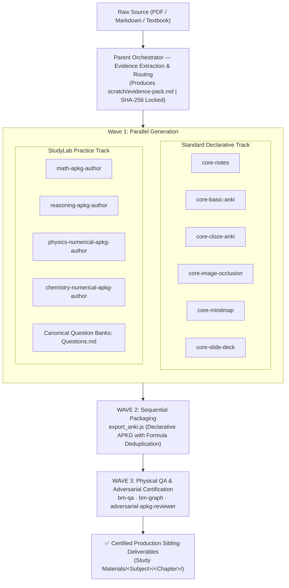

# StudySourceCore — Autonomous Study Asset Orchestration Engine

[](file:///c:/Users/Suraj/Documents/Antigravity/Studycore/CHANGELOG.md)
[-brightgreen?style=flat-square&logo=vitest)](file:///c:/Users/Suraj/Documents/Antigravity/Studycore/skills/study-source-core/scripts/run_all_tests.js)
[-success?style=flat-square)](file:///c:/Users/Suraj/Documents/Antigravity/Studycore/skills/study-source-core/scripts/run_master_smoke_test.js)
[](file:///c:/Users/Suraj/Documents/Antigravity/Studycore/skills/study-source-core/scripts/doctor.js)
[-orange?style=flat-square)](file:///c:/Users/Suraj/Documents/Antigravity/Studycore/DECISIONS.md)
[](file:///c:/Users/Suraj/Documents/Antigravity/Studycore/skills/study-source-core/SKILL.md)
[](file:///c:/Users/Suraj/Documents/Antigravity/Studycore/skills/study-source-core/scripts/mcp_server.js)

> **Canonical Architecture**: [`ARCHITECTURE.md`](file:///c:/Users/Suraj/Documents/Antigravity/Studycore/ARCHITECTURE.md)  
> **Master Changelog**: [`CHANGELOG.md`](file:///c:/Users/Suraj/Documents/Antigravity/Studycore/CHANGELOG.md)  
> **Product Charter**: [`PRODUCT.md`](file:///c:/Users/Suraj/Documents/Antigravity/Studycore/PRODUCT.md)  
> **Plugin Usage Guide**: [`docs/PLUGIN_USAGE.md`](file:///c:/Users/Suraj/Documents/Antigravity/Studycore/docs/PLUGIN_USAGE.md)  
> **Implementation Roadmap**: [`ROADMAP.md`](file:///c:/Users/Suraj/Documents/Antigravity/Studycore/ROADMAP.md)  
> **Learning Principles**: [`docs/LEARNING_PRINCIPLES.md`](file:///c:/Users/Suraj/Documents/Antigravity/Studycore/docs/LEARNING_PRINCIPLES.md)  
> **Final 360° Audit Report**: [`docs/audits/FINAL_360_AUDIT_REPORT.md`](file:///c:/Users/Suraj/Documents/Antigravity/Studycore/docs/audits/FINAL_360_AUDIT_REPORT.md)  
> **Version**: `v1.2.0-stable` Production Release  
> **Status**: Certified / Production Stable (100% Green | 45/45 Test Suites PASS | 19/19 Smoke Gates PASS | 4/4 Adversarial Certification Gates)  
> **Architecture**: 14-Agent Multi-Agent System with 6-Tier Pipeline & 3-Wave Execution

---

> [!IMPORTANT]
> ### ⚡ Core Reality: Antigravity 2.0 Native Skill & Plugin Pack
> **What this repository ACTUALLY is**: This entire repository is an **Antigravity 2.0 Native Skill / Plugin Pack**.
> - **Host Runtime**: **Google Antigravity 2.0 IS the orchestrator, runtime, and LLM reasoning engine.**
> - **Master Skill Entrypoint**: [`skills/study-source-core/SKILL.md`](file:///c:/Users/Suraj/Documents/Antigravity/Studycore/skills/study-source-core/SKILL.md) is the primary skill invoked inside Antigravity sessions.
> - **14 Subagents**: Files in [`.agents/agents/*.md`](file:///c:/Users/Suraj/Documents/Antigravity/Studycore/.agents/agents/) are prompt templates and behavioral contracts for Antigravity subagents spawned via `invoke_subagent`.
> - **Deterministic Helpers**: Scripts in [`skills/study-source-core/scripts/`](file:///c:/Users/Suraj/Documents/Antigravity/Studycore/skills/study-source-core/scripts/) are lightweight Node.js/Python safety rails (linting, TSV formatting, SQLite packaging, AST auditing) called by Antigravity or exposed via the local MCP server ([`mcp_server.js`](file:///c:/Users/Suraj/Documents/Antigravity/Studycore/skills/study-source-core/scripts/mcp_server.js)).
> - **Output Vault**: Local Obsidian vault layout under `Study Materials/<Subject>/<Chapter>/`.
> - **🚨 CRITICAL DIRECTIVE FOR AI AGENTS**: Do NOT attempt to build an independent SaaS compiler engine, custom event loops, or standalone runtime frameworks. Treat this repository strictly as an **Antigravity skill plugin pack with deterministic tool helpers**. Overengineering this repository breaks Antigravity's native agentic lifecycle.

---

## What is this?

**StudySourceCore** is a production-grade, deterministic multi-agent orchestration skill pack for Antigravity that ingests authorized study sources (PDFs, textbook chapters, exam papers) and synthesizes a complete ecosystem of high-yield study deliverables in parallel — automatically.

It operates on the canonical six-tier architecture:  
`AUTHORIZED SOURCE → EVIDENCE PACK → SEMANTIC LEARNING IR → PEDAGOGICAL COMPILER → RENDERERS → INDEPENDENT CERTIFICATION`.

One source in → clean sibling artifacts out.



---

## The Clean Triad Framework (ADR-25) & Cognitive Architecture

To eliminate the **"Overengineering Trap"** (procrasti-learning, collector's fallacy, and flashcard fatigue caused by generating 12+ files per chapter), StudySourceCore enforces **The Clean Triad of Learning Separation (ADR-25)**:

```
┌────────────────────────────────────────────────────────────────────────┐
│                        THE CLEAN LEARNING TRIAD                        │
├────────────────────────────────────────────────────────────────────────┤
│ 1. ANKI FLASHCARDS (Active Reflex Recall | 5–15s / card)               │
│    • Formulas, definitions, boundary conditions, examiner traps        │
│    • STRICT ZERO-SCRATCHPAD RULE: No multi-step algebra in Anki        │
├────────────────────────────────────────────────────────────────────────┤
│ 2. OBSIDIAN NOTES (Conceptual Anchor & Error Reference)                │
│    • Single H1, monotonic hierarchy, mental models, FBDs, proofs       │
│    • Consulted ONLY during initial recon or when a problem is failed   │
├────────────────────────────────────────────────────────────────────────┤
│ 3. OBSIDIAN QUESTION BANK (Deliberate Practice | Pen & Paper)          │
│    • Canonical Problem Families with high variation & authentic traps  │
│    • 4-option MCQs with misconception distractors                      │
│    • Default-collapsed hints (> [!tip]-) & full DAGs (> [!success]-)   │
└────────────────────────────────────────────────────────────────────────┘
```

### Cognitive Science Grounding
1. **Piotr Wozniak's Minimum Information Principle (MIP)**: Cards must require $\le 5-15$ seconds of reflex retrieval. Multi-step calculations in Anki violate the MIP, leading to review queues that explode and cards that become permanent leeches.
2. **Dunlosky et al. (2013) & Karpicke (2011)**: Practice testing ($d \ge 0.70$) yields the highest retention efficacy when separated into distinct cognitive modalities: active reflex memory vs deliberate pen-and-paper problem-solving.
3. **Sweller's Cognitive Load Theory**: Eliminates split-attention effect and cognitive friction by strictly separating atomic recall from multi-stage procedural reasoning.

---

### The 4 Universal Cognitive Archetypes ("Ginti Ki Cheezein")

Every subject domain is governed by its authoritative blueprint under [`docs/subjects/`](file:///c:/Users/Suraj/Documents/Antigravity/Studycore/docs/subjects/README.md), strictly enforcing 2–3 active deliverables while banning redundant bloat:

| Cognitive Archetype | Example Subjects | Active High-Yield Weapons | Strictly Banned Bloat |
|---|---|---|---|
| **1. Calculational STEM** | Mathematics, Physics, Physical Chemistry | • **Question Bank** (`Questions.md`) with 4-option MCQs, 3-tier hints & solution DAGs<br>• **Atomic Formula Anki** (5–10s reflex recall via `_Anki.apkg`)<br>• **Lean Conceptual Notes** (mental models, FBDs, derivations) | ❌ Multi-step scratchpad algebra in Anki<br>❌ Narrative essay notes & lecture transcripts<br>❌ Mindmaps and slide decks as study tools |
| **2. Deductive Logic** | Reasoning, Syllogisms, Arrangement Puzzles | • **Deductive Question Bank** (`Questions.md`) with Logic DAGs & constraint tables<br>• **Notation & Fallacy Anki** (5–10s rule cards)<br>• **Visual Decision Schematics** | ❌ Memorizing puzzle steps/solutions in Anki<br>❌ Prose essay notes |
| **3. Declarative High-Fact** | History, Polity, Inorganic Chemistry | • **High-Density Spaced Anki** (Basic & Cloze cards via `_Anki.apkg`)<br>• **Thematic Comparative Notes** (chronological timelines, treaties, comparative tables) | ❌ Procedural Question Banks<br>❌ 50-branch rainbow mindmaps |
| **4. Visual-Spatial** | Map, Geography, Biology Anatomy | • **Native Anki Image Occlusion** (`_IO.json` + SVG masks with true coordinates)<br>• **Terminology Cloze Anki** (geographic features, anatomical labels)<br>• **Spatial Anchor Notes** | ❌ Pure text border/location cards<br>❌ Procedural numerical question banks |

---

## Deliverables Generated (per chapter)

| Track | Output File | Format | Operational Role | Status |
|---|---|---|---|---|
| **Notes** | `Notes/<Chapter>_Notes.md` | Obsidian Markdown + YAML frontmatter | Conceptual Anchor & Error Reference | Active Primary |
| **Basic Flashcards** | `Basic/<Chapter>_Basic.tsv` | 3-column TSV → Anki import | Atomic Factual Recall | Active Primary |
| **Cloze Flashcards** | `Cloze/<Chapter>_Cloze.tsv` | Cloze `{{c1::}}` TSV → Anki import | Contextual Vocabulary & Formulas | Active Primary |
| **Image Occlusion** | `ImageOcclusion/<Chapter>_IO.json` | SVG coordinate mask manifest | Spatial Memory (Anatomy / Maps) | Active Primary |
| **Unified Deck** | `<Chapter>_Anki.apkg` | Compiled Anki Package (`.apkg`) | Spaced Repetition Reflex Memory | Active Primary |
| **Practice Question Bank** | `Questions/<Chapter>_Questions.md` | Markdown Question Bank (4-option MCQs, 3-tier hints, DAGs) | Pen-and-Paper Deliberate Practice | Active Primary (STEM / Reasoning) |
| **MindMap** | `MindMap/<Chapter>_MindMap.md` | Mermaid diagram + JSON concept tree | Spatial Chapter Orientation | Conditional (Non-STEM) |
| **Slide Deck** | `SlideDeck/<Chapter>_SlideDeck.md` | Marp presentation deck | Quick Pedagogical Walkthrough | Conditional |
| **Procedural APKG** | `StudyLab/<Chapter>_StudyLab_Procedural.apkg` | Anki `.apkg` binary | Interactive Step Cards | Permanently Archived (ADR-24 / ADR-25) |

---

## Master Repository Structure

```
StudySourceCore/
├── README.md                       ← Master repository overview, setup, and quickstart
├── CHANGELOG.md                    ← Authoritative Keep a Changelog history (v1.0.0 to v1.2.0-stable)
├── PRODUCT.md                      ← Product Charter, 10 Immutable Principles, non-goals
├── ARCHITECTURE.md                 ← Canonical 6-Tier Architecture & Contract Matrix
├── ROADMAP.md                      ← Master Implementation Roadmap (Phases 0–23 Certified)
├── CONTRIBUTING.md                 ← Developer workflow, testing, PR guidelines
├── DECISIONS.md                    ← Architectural Decision Records (ADR-01 through ADR-25)
│
├── docs/                           ← Tier 1: Canonical Technical Specifications & Blueprints
│   ├── LEARNING_PRINCIPLES.md      ← Cognitive load, 4-stage progression, 17 dimensions
│   ├── SUBJECT_POLICIES.md         ← 9-subject artifact matrix, 4 archetypes & suppression codes
│   ├── STUDYLAB_SPECIFICATION.md   ← StudyLab procedural IR, 3-tier hints, DAGs
│   ├── KNOWLEDGE_UNITS.md          ← Knowledge Units (KU), deduplication, reservations
│   ├── VISUAL_LEARNING.md          ← 9-stage visual pipeline, IO coordinate constraints
│   ├── PROVENANCE_AND_LINEAGE.md   ← 4-tier provenance hierarchy & 11-field CLR schema
│   ├── VALIDATION_AND_CERTIFICATION.md ← 5 quality stages, 15 adversarial checks (ADV-01..15)
│   ├── ORCHESTRATION_AND_EXECUTION.md  ← Subagent DAGs, Parent Self-Execution Ban
│   ├── RENDERING_PIPELINE.md       ← 7 format renderers, Markdown projection philosophy
│   ├── ANKI_INTEGRATION.md         ← Dual APKG v1.0, Model IDs 1600000001–1600000004
│   ├── SECURITY_AND_TRUST.md       ← Zero-trust model, path traversal, injection defenses
│   ├── GOVERNANCE.md               ← Authority hierarchy, ADR protocol, single-rule ownership
│   ├── GAP_REGISTER.md             ← Authoritative register of architectural gaps & resolutions
│   ├── CURRENT_IMPLEMENTATION.md   ← Active baseline assessment & test inventory
│   ├── subjects/                   ← Tier 1: Canonical 9 Subject Pedagogical Blueprints (01_MATH..09_MAP + README)
│   ├── audits/                     ← Authoritative audit reports (FINAL_360_AUDIT_REPORT.md, etc.)
│   └── archive/                    ← Retired drafts & archive indexes
│
├── .agents/                        ← Tier 2: Machine Governance & Subagent Definitions
│   ├── README.md                   ← Agent Operations Manual
│   ├── AGENTS.md                   ← Master Subagent Registry (14 standardized profiles)
│   ├── OWNERSHIP.md                ← Single Responsibility Matrix & Single-Writer Rule
│   ├── DATA_FLOW.md                ← End-to-End Pipeline & Message Schemas
│   ├── EXECUTION_LIFECYCLE.md      ← 3-Wave Protocol, Concurrency Caps, Timeouts
│   ├── FREEZE_MAP.md               ← 5-Tier Component Governance
│   ├── TROUBLESHOOTING.md          ← Diagnostic Trees for 9 Failure Classes
│   ├── SKILLS.md                   ← Skills Registry
│   ├── RESOURCES.md                ← Schemas & Contracts Index
│   ├── SCRIPTS.md                  ← Executable Scripts Registry
│   ├── skills.json                 ← Native Antigravity skills discovery config ("skills")
│   └── agents/                     ← 14 Canonical Agent Specifications
│       ├── core-notes.md
│       ├── core-basic-anki.md
│       ├── core-cloze-anki.md
│       ├── core-image-occlusion.md
│       ├── core-mindmap.md
│       ├── core-slide-deck.md
│       ├── bm-graph.md
│       ├── bm-qa.md
│       ├── math-apkg-author.md
│       ├── reasoning-apkg-author.md
│       ├── physics-numerical-apkg-author.md
│       ├── chemistry-numerical-apkg-author.md
│       ├── mold-gap-auditor.md
│       └── adversarial-apkg-reviewer.md
│
├── skills/
│   └── study-source-core/          ← StudySourceCore Engine, Tools & Subject Skills
│       ├── SKILL.md                ← Master orchestration skill instructions
│       ├── package.json            ← Dependencies & 45-suite test harness
│       ├── resources/              ← Schemas (Draft-07), contracts, rulebooks
│       ├── scripts/                ← Packaging, validation, and orchestration engines
│       └── subject-skills/         ← 9 Subject Domain Skills
│
├── Study Materials/                ← Production study vault deliverables (Notes, TSV, APKG, Questions)
└── scratch/                        ← Ephemeral evidence packs, IR artifacts, checkpoints
```

---

## The 14 Subagents

StudySourceCore coordinates **14 specialized, single-responsibility subagents** across 3 operational classes under the **Single-Writer Rule** and **Parent Self-Execution Ban**:

### 1. Generic Content Specialists (Wave 1 Parallel)

| Agent | Deliverable | Suppression Code |
|---|---|---|
| [`core-notes`](file:///c:/Users/Suraj/Documents/Antigravity/Studycore/.agents/agents/core-notes.md) | Obsidian Markdown notes with YAML frontmatter | — |
| [`core-basic-anki`](file:///c:/Users/Suraj/Documents/Antigravity/Studycore/.agents/agents/core-basic-anki.md) | Atomic Q&A flashcards (3-column TSV) | `ZERO_BASIC_CANDIDATES` |
| [`core-cloze-anki`](file:///c:/Users/Suraj/Documents/Antigravity/Studycore/.agents/agents/core-cloze-anki.md) | Cloze deletion flashcards (`{{c1::}}` TSV) | `ZERO_CLOZE_CANDIDATES` |
| [`core-image-occlusion`](file:///c:/Users/Suraj/Documents/Antigravity/Studycore/.agents/agents/core-image-occlusion.md) | SVG bounding-box IO manifest (`_IO.json`) | `NO_IO_CANDIDATES` |
| [`core-mindmap`](file:///c:/Users/Suraj/Documents/Antigravity/Studycore/.agents/agents/core-mindmap.md) | Mermaid mindmap + JSON tree | `NO_RELATIONAL_TOPOLOGY` |
| [`core-slide-deck`](file:///c:/Users/Suraj/Documents/Antigravity/Studycore/.agents/agents/core-slide-deck.md) | Marp presentation deck | `DECK_WORTHINESS_BELOW_THRESHOLD` |

### 2. StudyLab Procedural Specialists (Wave 1 Parallel)

> [!NOTE]
> **Operational Policy (GAP-30 / ADR-24 / ADR-25)**: Procedural specialists author canonical Markdown Question Banks (`Questions.md`) as the 100% active primary deliberate practice deliverable. Binary Procedural APKG packaging is permanently archived in production.

| Agent | Domain Coverage | Primary Deliverable | Suppression Code |
|---|---|---|---|
| [`math-apkg-author`](file:///c:/Users/Suraj/Documents/Antigravity/Studycore/.agents/agents/math-apkg-author.md) | 59 Math topics — coprime constraints, Solution DAGs, 3-tier hints | `Questions/<Chapter>_Questions.md` | `ZERO_MATH_CANDIDATES` |
| [`reasoning-apkg-author`](file:///c:/Users/Suraj/Documents/Antigravity/Studycore/.agents/agents/reasoning-apkg-author.md) | 30 Reasoning topics — syllogisms, seating, matrix puzzles | `Questions/<Chapter>_Questions.md` | `ZERO_REASONING_CANDIDATES` |
| [`physics-numerical-apkg-author`](file:///c:/Users/Suraj/Documents/Antigravity/Studycore/.agents/agents/physics-numerical-apkg-author.md) | 40 Physics topics — calculational only, 6-stage pipeline | `Questions/<Chapter>_Questions.md` | `DESCRIPTIVE_ONLY_NO_NUMERICALS` |
| [`chemistry-numerical-apkg-author`](file:///c:/Users/Suraj/Documents/Antigravity/Studycore/.agents/agents/chemistry-numerical-apkg-author.md) | Chemistry — stoichiometry, ICE tables, mechanisms | `Questions/<Chapter>_Questions.md` | `DESCRIPTIVE_ROTE_NO_CALCULATIONS` |

### 3. Downstream QA & Audit Specialists (Wave 3 Post-Packaging)

| Agent | Operational Role |
|---|---|
| [`bm-graph`](file:///c:/Users/Suraj/Documents/Antigravity/Studycore/.agents/agents/bm-graph.md) | Vault knowledge graph — Obsidian cross-note Wikilinks |
| [`bm-qa`](file:///c:/Users/Suraj/Documents/Antigravity/Studycore/.agents/agents/bm-qa.md) | Cross-artifact factual consistency audit across sibling files |
| [`mold-gap-auditor`](file:///c:/Users/Suraj/Documents/Antigravity/Studycore/.agents/agents/mold-gap-auditor.md) | Contract registry audit (REUSE / EXTEND / CREATE classification) |
| [`adversarial-apkg-reviewer`](file:///c:/Users/Suraj/Documents/Antigravity/Studycore/.agents/agents/adversarial-apkg-reviewer.md) | 15-point attack harness — DAG topology, hint leaks, MCQ invariants |

---

## Core Architectural Invariants

1. **Single Source of Truth** — All generation derives from one SHA-256-locked `evidence-pack.md`. No subagent re-parses raw PDFs.
2. **Single-Writer Rule** — Exactly one designated agent writes to each target deliverable. No concurrent writes to the same artifact.
3. **Parent Self-Execution Ban** — The parent orchestrator coordinates, routes, gates, and audits, but never authors specialist deliverables.
4. **Deterministic Gating** — Every suppressed track emits an explicit auditable reason code. Zero silent omissions.
5. **MCQ Hard Invariant** — Every practice question has $\ge 4$ distinct options with exactly 1 correct answer and balanced option distribution (eradicating Option A bias).
6. **Hindi-first Language Contract** — Explanatory prose is Hindi-first; technical/domain terms appear in English in parentheses.
7. **Hard Resource Limits** — Max 4 concurrent subagents; max 10 total launches per mission.
8. **Physical Completion Gates** — Artifacts must exist on disk with `size > 0`, pass AJV schema validation, and SQLite integrity checks.
9. **Strict Script De-Usurpation Invariant** — No script is allowed to make pedagogical decisions (fabricating hints, inventing distractors, synthesizing mock DAGs). Pedagogy belongs exclusively to LLM specialists; mechanical packaging belongs exclusively to deterministic scripts.
10. **Fail-Closed Pedagogical Integrity** — Missing authoritative hints or detected answer leaks trigger fail-closed fatal errors (`[HINT_ANSWER_LEAKAGE_FATAL]`). Scripts never silently synthesize synthetic filler to mask upstream defects.
11. **Formula Deduplication Rule** — Basic cards whose equations are already atomically tested in Cloze flashcards are deterministically pruned during APKG compilation (`export_anki.js`), cutting redundant review burden by 50–70%.
12. **Zero-Mock Production Invariant** — Production authoring engines and scripts never fall back to sample test fixtures or mock data.

---

## Test Health & Quality Certifications

StudySourceCore maintains rigorous, multi-tiered automated verification:

| Verification Suite | Command | Total Gates / Suites | Status | Execution Time |
|---|---|:---:|:---:|:---:|
| **Master Test Suite** | `npm test` | **45 / 45** Suites | 🟢 **100% PASS** | ~37s |
| **Master Smoke Test** | `npm run smoke` | **19 / 19** Gates | 🟢 **100% PASS** | ~4.5s (Zero-Mock) |
| **Environment Doctor** | `npm run doctor` | **8 / 8** Checks | 🟢 **HEALTHY** | < 1s |
| **Adversarial Certification** | `npm run certify -- --all` | **6 / 6** Chapters (4 Gates/ch) | 🟢 **100% PASS** | ~12s |

---

## Prerequisites & Dependencies

### Required Dependencies

| Dependency | Minimum Version | Recommended | Operational Purpose |
|---|---|---|---|
| **Node.js** | `>= 18.0.0` | `v20.x` or `v22.x` (LTS) | Core engine execution, packaging pipelines, MCP server, and test harnesses |
| **npm** | `>= 9.0.0` | `v10.x+` | Skill dependency management and execution scripts |
| **Git** | `>= 2.30.0` | Latest release | Repository version control and workspace lineage tracking |

### Optional Helpers

- **Python 3 (`>= 3.10`)**: Optional helper required *only* for standalone PDF page counting and structural outline extraction via [`pdf_inventory.py`](file:///c:/Users/Suraj/Documents/Antigravity/Studycore/skills/study-source-core/scripts/pdf_inventory.py).
- **Anki Desktop (`>= 24.x`)**: Optional GUI tool for manual inspection and spaced repetition review of generated `.apkg` packages (`Study Materials/**/<Chapter>_Anki.apkg`). Not needed for headless generation or automated verification.

---

## Installation & Workspace Setup

Google Antigravity utilizes **project-level skills** located directly within the workspace under `skills/study-source-core/`. The root workspace acts as the operational envelope, housing student deliverables in `Study Materials/` and ephemeral compilation caches in `scratch/`.

```bash
# 1. Clone the repository
git clone https://github.com/naksh-07/study-source-core.git
cd study-source-core

# 2. Install Skill Engine Dependencies
cd skills/study-source-core
npm ci

# 3. Verify Environment, Smoke Test & Master Test Suite
npm run doctor       # 8/8 Environment health checks
npm run smoke        # 19-Gate Master Smoke Test (Zero Mocks, ~4.5s)
npm run telemetry    # Token economy & production calibration scorecard
npm test             # 45 automated CommonJS test suites (100% green, ~37s)
```

---

## Model Context Protocol (MCP) Server Setup

StudySourceCore includes a native Model Context Protocol (MCP) server located at [`skills/study-source-core/scripts/mcp_server.js`](file:///c:/Users/Suraj/Documents/Antigravity/Studycore/skills/study-source-core/scripts/mcp_server.js), exposing 6 deterministic tools via `stdio` transport (complete specification: [`docs/MCP_SERVER_API.md`](file:///c:/Users/Suraj/Documents/Antigravity/Studycore/docs/MCP_SERVER_API.md)):

| MCP Tool | Operational Purpose |
|---|---|
| `export_anki_package` | Compiles Basic, Cloze, and Image Occlusion flashcards into one unified standard Anki `.apkg` package with mathematical formula containment deduplication. |
| `export_studylab_procedural_package` | Compiles STEM StudyLab practice questions, solution DAGs, and 3-tier progressive hints into an interactive procedural `.apkg` package (Archived in production). |
| `validate_artifact` | Validates artifacts against pedagogical contracts (TSVs, StudyLab JSONs, LaTeX math syntax, Mermaid diagrams, APKG SQLite integrity). |
| `resolve_subject_policy` | Resolves authoritative artifact eligibility rules and domain suppressions for any academic subject. |
| `ingest_source_to_evidence_pack` | Deterministically slices and extracts source text via PyMuPDF/OCR into SHA-256 evidence packs. |
| `query_procedural_contract` | Queries canonical contracts, solution DAG molds, and hint specifications directly from SQLite WAL `procedural.db`. |

### Antigravity Configuration (`mcp_config.json`)

To configure the StudySourceCore MCP server in Google Antigravity, add the `studysource-core` entry to your Antigravity configuration file (`mcp_config.json`):

```json
{
  "mcpServers": {
    "studysource-core": {
      "command": "node",
      "args": [
        "C:/Users/Suraj/Documents/Antigravity/Studycore/skills/study-source-core/scripts/mcp_server.js"
      ]
    }
  }
}
```

> [!IMPORTANT]
> Replace the argument path above with the exact absolute path to `mcp_server.js` on your local filesystem.

---

## Unified CLI Driver (`studycore`) & Certified Production Catalog

StudySourceCore provides a unified CLI driver [`studycore_cli.js`](file:///c:/Users/Suraj/Documents/Antigravity/Studycore/skills/study-source-core/scripts/studycore_cli.js) to manage the entire study artifact lifecycle:

```bash
# Check status of all chapters across the production vault
node skills/study-source-core/scripts/studycore_cli.js status

# Run modular execution (Full Suite or Granular On-Demand via --only)
node skills/study-source-core/scripts/studycore_cli.js run <Subject> <Chapter> [--only <target>]
# Examples:
#   studycore run Math LCM-HCF --only notes
#   studycore run Reasoning Syllogisms --only qbank
#   studycore run Biology Photosynthesis --only flashcards

# Dispatch genuine specialist subagents for a chapter (Wave 1, 2, or 3)
node skills/study-source-core/scripts/studycore_cli.js dispatch <Subject> <Chapter> [--wave 1|2|3]

# Package declarative Anki APKG with formula deduplication
node skills/study-source-core/scripts/studycore_cli.js package <Subject> <Chapter>

# Verify all deliverables for a chapter and emit canonical .completion-evidence.json
node skills/study-source-core/scripts/studycore_cli.js verify <Subject> <Chapter>

# Run independent 4-gate adversarial certification on a chapter
node skills/study-source-core/scripts/studycore_cli.js certify <Subject> <Chapter>

# Run independent 4-gate adversarial certification across all production chapters in one pass
node skills/study-source-core/scripts/studycore_cli.js certify --all
# (Or using npm: npm run certify -- --all)
```

### Certified Production Vault Catalog (6 Chapters Across 5 Domains)

| Domain | Chapter | Notes | Flashcards | MindMap | Deck | Question Bank (GAP-30) | APKG | Certification |
|---|---|---|---|---|---|---|---|---|
| **Map** | `Europe` | ✅ Comprehensive | ✅ 14 Basic + 10 Cloze | ✅ MindMap | ✅ SlideDeck | ⚪ N/A (Visual) | ✅ 25-Note Unified (24 IO Masks) | 🟢 4/4 PASS |
| **Mathematics** | `LCM-HCF` | ✅ Verified | ✅ 20 Basic + 20 Cloze | ⚪ Suppressed | ⚪ Suppressed | ✅ 8 MCQs (3-Tier Hints, Zero Leaks) | ✅ Unified APKG | 🟢 4/4 PASS |
| **Mathematics** | `Arithmetic-Progression` | ✅ 2,400+ words | ✅ 20 Basic + 20 Cloze | ✅ 34 Nodes | ✅ 8 Slides | ✅ 26 MCQs (CBSE/SSC/CDS) | ✅ 27-Card APKG | 🟢 4/4 PASS |
| **Physics** | `Newton-Laws-Friction` | ✅ 3,100+ words | ✅ 20 Basic + 20 Cloze | ✅ 36 Nodes | ✅ 8 Slides | ✅ 25 Numerical MCQs (10 Diverse Scenarios) | ✅ 23-Card Unified | 🟢 4/4 PASS |
| **Reasoning** | `Syllogism` | ✅ 2,600+ words | ✅ 20 Basic + 20 Cloze | ✅ 32 Nodes | ✅ 8 Slides | ✅ 25 MCQs (SSC/RRB/IBPS) | ✅ 34-Card APKG | 🟢 4/4 PASS |
| **Chemistry** | `Chemical-Equilibrium` | ✅ 2,911 words | ✅ 20 Basic + 20 Cloze | ✅ 38 Nodes | ✅ 8 Slides | ✅ 25 MCQs (4-Option MCQs, ICE Tables) | ✅ 40-Card APKG | 🟢 4/4 PASS |

---

## Safe Lifecycle Management

```mermaid
flowchart TD
    subgraph Update ["Safe Update Lifecycle"]
        U1["git fetch && git pull"] --> U2["cd skills/study-source-core && npm ci"]
        U2 --> U3["npm run doctor (8/8 healthy)"]
        U3 --> U4["npm test (45/45 suites pass)"]
        U4 --> U5["Study Materials/ untouched ✅"]
    end

    subgraph Teardown ["Safe Uninstall Lifecycle"]
        T1["Backup Study Materials/ & *.apkg"] --> T2["Remove studysource-core from mcp_config.json"]
        T2 --> T3["Remove scratch/* transients"]
        T3 --> T4["Remove repository clone"]
        T4 --> T5["Other Antigravity skills unaffected ✅"]
    end
```



### Safe Update Lifecycle
To safely update StudySourceCore when upstream updates or schema improvements are released:
1. `git fetch origin && git pull origin main`
2. `cd skills/study-source-core && npm ci`
3. `npm run doctor` (validates runtime environment)
4. `npm run smoke` (asserts 19 zero-mock architectural anti-tamper gates)
5. `npm test` (verifies 45 test suites pass 100% green)

> [!NOTE]
> **Zero User Deliverable Impact**: All generated study deliverables in `Study Materials/` remain **completely untouched** during git pulls and npm updates. Skills, schemas, and validators update in-place within `skills/study-source-core/`.

---

## Key Design Decisions (ADRs)

See [`DECISIONS.md`](file:///c:/Users/Suraj/Documents/Antigravity/Studycore/DECISIONS.md) for the full Architectural Decision Record log (ADR-01 through ADR-25).

| ADR | Title & Key Decision |
|---|---|
| **ADR-01** | SHA-256 Evidence Lineage — single immutable evidence pack |
| **ADR-02** | Single-Writer Rule & Parent Self-Execution Ban |
| **ADR-03** | 3-Wave Pipeline with hard concurrency caps ($\le 4$) |
| **ADR-04** | Deterministic gating with auditable suppression codes |
| **ADR-05** | Hard layer isolation — SQLite / APKG / frontend runtimes |
| **ADR-06** | Native Level 1-7 StudyLab first-class integration |
| **ADR-07** | Source-first practice hierarchy (`authentic_pyq ≻ curated ≻ derived ≻ synthetic`) |
| **ADR-08** | MCQ Hard Invariant ($\ge 4$ options, 1 correct, SQLite-persisted, balanced options) |
| **ADR-09** | 1-retry targeted correction with blast-radius isolation |
| **ADR-10** | Physical completion gating + Hindi-first dual-language contract |
| **ADR-11** | Canonical 6-Tier Pipeline & Semantic Learning IR Decoupling |
| **ADR-12** | Preservation & Normalization of 17 Procedural Dimensions |
| **ADR-13** | 4-Stage Procedural Scaffolding & Interleaving Boundary |
| **ADR-14** | Dual APKG Architecture for v1.0 / Unified Target for v1.1 |
| **ADR-15** | Fail-Closed Visual Learning Policy (`NO_APPROVED_ASSET`) |
| **ADR-16** | Content Lineage Record (CLR) Cryptographic Tracing |
| **ADR-17** | Scope Boundaries & Deferred Runtimes (SQLite DB, Web UI post-v1.0) |
| **ADR-18** | Strict Script De-Usurpation & Fail-Closed Pedagogical Integrity |
| **ADR-19** | Mechanical vs Cognitive Separation of Concerns |
| **ADR-20** | Antigravity Native Skills Discovery Bridge & Global Duplicate Purge |
| **ADR-21** | Anti-Hardcoding & Zero-Mock Production Hardening |
| **ADR-22** | Question Bank Primary Policy & Gate 2 Certification Fallback |
| **ADR-23** | Safe Programmatic Audit Libraries & Unified Certification CLI |
| **ADR-24** | Procedural APKG Archival & Markdown Question Bank Primacy |
| **ADR-25** | The Clean Triad, Cognitive Science Alignment & Minimalist Subject Blueprints |

---

## Operational Documents

| Document | Purpose |
|---|---|
| [`CHANGELOG.md`](file:///c:/Users/Suraj/Documents/Antigravity/Studycore/CHANGELOG.md) | Authoritative Keep a Changelog history (v1.0.0 through v1.2.0-stable) |
| [`AGENTS.md`](file:///c:/Users/Suraj/Documents/Antigravity/Studycore/AGENTS.md) | Master registry of all 14 agents (14-section standard spec) |
| [`OWNERSHIP.md`](file:///c:/Users/Suraj/Documents/Antigravity/Studycore/OWNERSHIP.md) | Single Responsibility Matrix — who writes what |
| [`DATA_FLOW.md`](file:///c:/Users/Suraj/Documents/Antigravity/Studycore/DATA_FLOW.md) | End-to-end 6-stage transformation pipeline & message schemas |
| [`EXECUTION_LIFECYCLE.md`](file:///c:/Users/Suraj/Documents/Antigravity/Studycore/EXECUTION_LIFECYCLE.md) | 3-Wave protocol, concurrency rules, timeout budgets |
| [`FREEZE_MAP.md`](file:///c:/Users/Suraj/Documents/Antigravity/Studycore/FREEZE_MAP.md) | 5-Tier governance — what is FROZEN vs MUTABLE |
| [`TROUBLESHOOTING.md`](file:///c:/Users/Suraj/Documents/Antigravity/Studycore/TROUBLESHOOTING.md) | Diagnostic trees for 9 failure classes |
| [`SCRIPTS.md`](file:///c:/Users/Suraj/Documents/Antigravity/Studycore/SCRIPTS.md) | CLI script reference with exit codes & usage |
| [`RESOURCES.md`](file:///c:/Users/Suraj/Documents/Antigravity/Studycore/RESOURCES.md) | 38 JSON schemas and rulebooks index |
| [`docs/audits/FINAL_360_AUDIT_REPORT.md`](file:///c:/Users/Suraj/Documents/Antigravity/Studycore/docs/audits/FINAL_360_AUDIT_REPORT.md) | Multi-expert 360-degree audit report & remediation scorecard |
| [`skills/study-source-core/resources/workflow.md`](file:///c:/Users/Suraj/Documents/Antigravity/Studycore/skills/study-source-core/resources/workflow.md) | Full 11-phase workflow specification |

---

## Tech Stack

- **Host Platform**: Google Antigravity (AGY) with Gemini models
- **Runtime**: Node.js v20+ / v22+ LTS (ES Modules & CommonJS interop)
- **Schema & Type Validation**: `ajv` v8 (Draft-07 JSON Schema) + `zod` (`^3.24.0`)
- **APKG Binary Compilers**: `better-sqlite3` + `jszip` (pure-memory SQLite streaming compiler with mathematical formula deduplication)
- **MCP Server**: `@modelcontextprotocol/sdk` (`^1.30.0`) — exposing 6 deterministic tools (see [`docs/MCP_SERVER_API.md`](file:///c:/Users/Suraj/Documents/Antigravity/Studycore/docs/MCP_SERVER_API.md))
- **Test Framework**: `vitest` v4 + CommonJS test harness (45 isolated suites passing 100% green in ~37s)
- **Presentation**: Marp (Markdown to slides)
- **Vault**: Obsidian (PKM with Wikilinks)

---

## License

Private academic research tool. Not for public redistribution.

---

*Built with Google Antigravity — an autonomous agentic AI coding assistant.*
