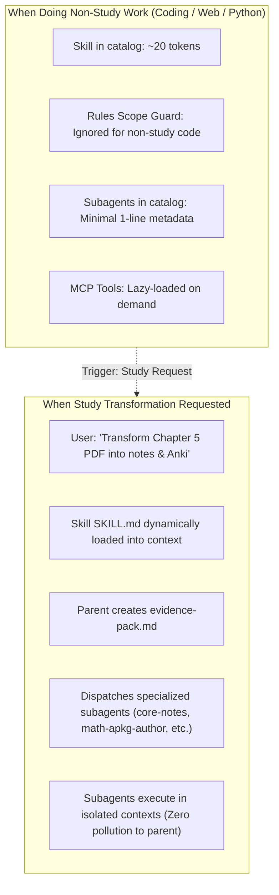

# StudySourceCore — Antigravity 2.0 Plugin Usage & Zero-Bloat Guide

> **Plugin ID**: `study-source-core`  
> **Version**: `1.2.0`  
> **Architecture**: Progressive Disclosure Multi-Agent Study Engine

---

## 1. Zero Context Bloat Architecture

One of the biggest concerns with global plugins is **context bloat** (injecting unnecessary instructions and tokens into every conversation). StudySourceCore is engineered from the ground up for **zero-bloat progressive disclosure**:

### Why It Won't Bloat Your Context:
1. **Progressive Skill Loading**: The full `SKILL.md` (and its reference docs) is **never** loaded into your session prompt by default. Only the 2-line name + description exists in the index until you explicitly trigger a study transformation.
2. **Subagent Context Isolation**: When subagents (`core-notes`, `math-apkg-author`, `core-basic-anki`) run, they execute in their own isolated subagent contexts. Their heavy 14-section system prompts never touch your main chat session.
3. **Lean Rules (< 30 lines)**: `rules/AGENTS.md` contains an explicit `Domain Scope` guard and consumes < 250 tokens total.
4. **Lazy MCP Tools**: MCP tools execute through stdio only when called.

---

## 2. How to Use Across Any Workspace

Because StudySourceCore is linked globally via NTFS Junction to `~/.gemini/config/plugins/study-source-core`, you can use it in **any folder or project** (Obsidian Vaults, Personal OS, Git repositories, etc.).

### Common Usage Scenarios

#### Scenario A: Transform a Textbook Chapter or Notes (Full Suite)
In any workspace, simply tell Antigravity:
> *"StudySourceCore use karke is chapter source `D:/Books/Physics/NewtonLaws.pdf` ko complete study artifacts me transform karo."*

**What Happens**:
1. Skill activates and extracts text to `scratch/evidence-pack.md` (SHA-256 locked).
2. Wave 1 subagents author:
   - `Notes/Newton-Laws_Notes.md` (Obsidian notes with bilingual explanations & tables)
   - `Basic/Newton-Laws_Basic.tsv` & `Cloze/Newton-Laws_Cloze.tsv` (Anki cards)
   - `Map/Newton-Laws_Mindmap.md` (Mermaid concept hierarchy)
   - `SlideDeck/Newton-Laws_SlideDeck.md` (Marp presentation deck)
3. Wave 2 packages `Newton-Laws_Anki.apkg`.
4. Wave 3 runs `bm-qa` and `bm-graph` for consistency and vault linking.

---

#### Scenario B: Generate Procedural Question Bank for STEM (Math/Physics/Chemistry/Reasoning)
> *"Is source ke basis pe LCM-HCF ka practice question bank banao."*

**What Happens**:
- `math-apkg-author` extracts authentic problems and generates `Questions/LCM-HCF_Questions.md` with:
  - Clean question stems and 4-option MCQs.
  - Collapsible-by-default 3-tier hints (`> [!tip]- संकेत (3-Tier Hints)`).
  - Collapsible step-by-step solutions (`> [!success]- उत्तर एवं विस्तृत हल`).
  - Zero accidental answer spoilers during study!

---

#### Scenario C: Direct MCP Tool Invocation
The plugin exposes 6 deterministic tools that can be invoked directly:
- `export_anki_package`: Compiles TSV + media into `.apkg`.
- `validate_artifact`: Runs fail-closed AST checks on notes, TSVs, mindmaps, YAML frontmatter, and question banks.
- `ingest_source_to_evidence_pack`: Parses source files with SHA-256 hashing.
- `resolve_subject_policy`: Queries subject-specific artifact generation matrices.
- `query_procedural_contract`: Searches STEM problem templates and parameter bounds.

---

## 3. Managing Plugin Lifecycle

If you ever want to temporarily disable or enable the plugin:

### Via Chat / CLI:
- **Enable**: `study-source-core` is enabled by default.
- **Disable** (stops background tools and hides subagents):
  Disable via Antigravity Settings $\to$ **Plugins** $\to$ **StudySourceCore Engine** (Toggle Off).

When disabled, **0 tokens** are used and no background processes remain active.
