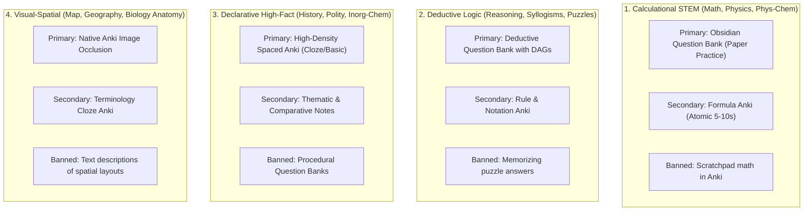

# StudySourceCore — Subject × Artifact Matrix & Domain Policy

> **Canonical Document**: `docs/SUBJECT_POLICIES.md`  
> **Status**: AUTHORITATIVE / FROZEN BASELINE  
> **Version**: 1.2.0-POLICY  
> **Governance Authority**: StudySourceCore Master Governance Board  
> **Core Directives**: Ponytail Standard & ADR-25 (The Clean Triad)  
> **Authoritative Blueprints**: [`docs/subjects/README.md`](subjects/README.md)  
> **Pedagogical Research**: [`docs/audits/PEDAGOGICAL_AND_COGNITIVE_SCIENCE_RESEARCH_REPORT.md`](audits/PEDAGOGICAL_AND_COGNITIVE_SCIENCE_RESEARCH_REPORT.md)  
> **Baseline Audit**: [`docs/audits/CURRENT_SUBJECT_STATE_AUDIT.md`](audits/CURRENT_SUBJECT_STATE_AUDIT.md)  

---

## 1. Domain-Aware Pedagogical Philosophy & The 4 Cognitive Archetypes

In StudySourceCore, **subject domain epistemology dictates artifact strategy**. Generating the same generic blend of flashcards, mindmaps, and notes across all subjects is treated as an architectural defect and an educational anti-pattern ("The Overengineering Trap"). 

Decades of cognitive psychology (Dunlosky 2013, Karpicke & Blunt 2011, Sweller Cognitive Load Theory) and practitioner consensus prove that forced uniformity damages retention:
- Forcing math or physics problems into flashcards induces **Flashcard Fatigue** and violates Piotr Wozniak's Minimum Information Principle (optimal card review: 5–15 seconds).
- Forcing history or political science into procedural equations produces **Meaningless Synthetic Gibberish**.
- Generating 6–8 disparate files per chapter triggers **The Collector's Fallacy** and **Procrasti-Learning**—students spend hours admiring notes and mindmaps while doing zero retrieval practice.

### The 4 Universal Cognitive Archetypes

Every academic subject in human learning maps to one of four foundational cognitive archetypes:



| Cognitive Archetype | Exemplar Subjects | Primary Pedagogical Weapon | Maintenance Mechanism | Strictly Banned Anti-Pattern |
|---|---|---|---|---|
| **1. Calculational STEM** | Math, Physics, Physical Chem | **Question Bank (`Questions.md`)** with 3-tier hints & solution DAGs | Atomic Formula Anki (5–10s reflex recall) | ❌ Scratchpad math in Anki<br>❌ Prose essay notes |
| **2. Deductive Logic** | Reasoning, Syllogisms, Puzzles | **Deductive Question Bank (`Questions.md`)** with Logic DAGs | Notation, Rule & Fallacy Anki | ❌ Memorizing puzzle answers<br>❌ Continuous prose |
| **3. Declarative High-Fact** | History, Polity, Inorganic Chem | **High-Density Spaced Anki** (`_Anki.apkg` via Cloze/Basic) | Thematic Notes & Comparative Tables | ❌ Procedural Question Banks<br>❌ 50-branch mindmaps |
| **4. Visual-Spatial** | Map, Geography, Biology Anatomy | **Native Anki Image Occlusion** (`_IO.json` + SVG masks) | Terminology Cloze Anki | ❌ Synthetic text flashcards for coordinates<br>❌ Pure prose lecture notes |

---

## 2. Artifact Policy States

Every artifact modality for a given subject is assigned one of five definitive policy states:

| Policy State | Operational Meaning | Generation Behavior |
|---|---|---|
| **CORE** | Mandatory pedagogical pillar for this subject. | Always dispatched when source evidence meets minimal volume thresholds. |
| **CONDITIONAL** | Generated if and only if justified by explicit source features. | Evaluated by `routing_engine.js`. If candidate count equals 0, suppressed with auditable code. |
| **LOW** | Discouraged or secondary modality for this subject. | Restricted to small candidate caps; suppressed if higher-yield modalities suffice. |
| **UNSUPPORTED** | Pedagogically contraindicated or structurally invalid. | Hard suppression. Disallowance enforced by `subject_policy_resolver.js`. |
| **ARCHIVED** | Permanently retired or paused in production (e.g. Procedural APKG under GAP-30 / ADR-24 / ADR-25). | Suppressed across all subjects. Primary practice is served directly via Markdown Question Banks. |

---

## 3. The Master Subject × Artifact Matrix

```
┌────────────────────────────────────────────────────────────────────────────────────────────────────────┐
│                                MASTER SUBJECT × ARTIFACT MATRIX                                        │
├──────────────────┬──────────┬──────────┬──────────┬──────────┬──────────┬──────────┬──────────┬────────┤
│ Subject Domain   │ Notes    │ Basic    │ Cloze    │ Image    │ MindMap  │ Slide    │ Proced.  │ Quest. │
│                  │ (Obsid.) │ Anki     │ Anki     │ Occlus.  │ (JSON)   │ Deck     │ APKG     │ Bank   │
├──────────────────┼──────────┼──────────┼──────────┼──────────┼──────────┼──────────┼──────────┼────────┤
│ **Biology**      │ CORE     │ CORE     │ CORE     │ CORE     │ CONDIT.  │ CONDIT.  │ ARCHIVED │ UNSUPP.│
├──────────────────┼──────────┼──────────┼──────────┼──────────┼──────────┼──────────┼──────────┼────────┤
│ **Chemistry**    │ CORE     │ CONDIT.  │ CORE     │ CONDIT.  │ CONDIT.  │ CONDIT.  │ ARCHIVED │ CORE*  │
├──────────────────┼──────────┼──────────┼──────────┼──────────┼──────────┼──────────┼──────────┼────────┤
│ **Geography**    │ CORE     │ CORE     │ CORE     │ CORE     │ CORE     │ CONDIT.  │ ARCHIVED │ UNSUPP.│
├──────────────────┼──────────┼──────────┼──────────┼──────────┼──────────┼──────────┼──────────┼────────┤
│ **History**      │ CORE     │ CORE     │ CORE     │ LOW      │ CORE     │ CORE     │ ARCHIVED │ UNSUPP.│
├──────────────────┼──────────┼──────────┼──────────┼──────────┼──────────┼──────────┼──────────┼────────┤
│ **Map**          │ CONDIT.  │ LOW      │ LOW      │ CORE     │ LOW      │ CONDIT.  │ ARCHIVED │ UNSUPP.│
├──────────────────┼──────────┼──────────┼──────────┼──────────┼──────────┼──────────┼──────────┼────────┤
│ **Math**         │ CONDIT.  │ LOW      │ LOW      │ LOW      │ LOW      │ LOW      │ ARCHIVED │ CORE   │
├──────────────────┼──────────┼──────────┼──────────┼──────────┼──────────┼──────────┼──────────┼────────┤
│ **Physics**      │ CORE     │ CONDIT.  │ CORE     │ CONDIT.  │ CONDIT.  │ CONDIT.  │ ARCHIVED │ CORE*  │
├──────────────────┼──────────┼──────────┼──────────┼──────────┼──────────┼──────────┼──────────┼────────┤
│ **Political Sc.**│ CORE     │ CORE     │ CORE     │ LOW      │ CORE     │ CONDIT.  │ ARCHIVED │ UNSUPP.│
├──────────────────┼──────────┼──────────┼──────────┼──────────┼──────────┼──────────┼──────────┼────────┤
│ **Reasoning**    │ LOW      │ UNSUPP.  │ LOW      │ CONDIT.  │ LOW      │ LOW      │ ARCHIVED │ CORE   │
└──────────────────┴──────────┴──────────┴──────────┴──────────┴──────────┴──────────┴──────────┴────────┘
```

> [!IMPORTANT]
> **Operational Policy (GAP-30 / ADR-24 / ADR-25)**:
> 1. **Procedural APKG (`ARCHIVED` across all subjects)**: Interactive procedural APKG binary packaging is permanently archived and inactive in production.
> 2. **Canonical Markdown Question Banks (`CORE` for STEM/Reasoning, `UNSUPPORTED` for Humanities)**: `Questions/<Chapter>_Questions.md` authored with strict 4-option MCQs (`(A)`, `(B)`, `(C)`, `(D)`), default-collapsed 3-tier hints (`> [!tip]-`), and step-by-step solution DAGs (`> [!success]-`) is the active primary practice deliverable for Math, Physics, Chemistry, and Reasoning.
> 3. **Descriptive Humanities**: Subjects such as History, Political Science, Geography, Biology, and Map suppress procedural question banks (`UNSUPPORTED` via `NON_PROCEDURAL_DOMAIN`), relying instead on high-density Anki and thematic notes.

---

## 4. "Ginti Ki Cheezein" (Minimalist Subject Blueprints)

To enforce Ponytail minimalism and eliminate bloated 12-file deliverables per chapter, StudySourceCore mandates **"Ginti Ki Cheezein"** (strictly 2–3 active high-yield deliverables per subject domain).

Authoritative detailed blueprints reside canonically under [`docs/subjects/`](subjects/README.md):

| # | Subject Blueprint | Cognitive Archetype | The "Ginti Ki Cheezein" (Active High-Yield Weapons) | Strictly Banned Bloat |
|---|---|---|---|---|
| 01 | [**`01_MATH.md`**](subjects/01_MATH.md) | Pure Quantitative STEM | • Question Bank (`Questions.md`) with 3-tier hints<br>• Lean Formula Anki (Atomic 5–10s only) | ❌ Scratchpad math in Anki<br>❌ Prose essay notes<br>❌ Mindmaps as study |
| 02 | [**`02_PHYSICS.md`**](subjects/02_PHYSICS.md) | Physical Modeling & Numericals | • 6-Stage Calculational Question Bank (`Questions.md`)<br>• Formula, Unit & Sign Anki<br>• FBD & Model Reference Notes | ❌ Numerical problems in Anki<br>❌ Pure qualitative lecture notes |
| 03 | [**`03_CHEMISTRY.md`**](subjects/03_CHEMISTRY.md) | Tri-Bifurcated (Phys/Inorg/Org) | • Physical: ICE Question Bank + Formula Anki<br>• Inorganic: High-Density Spaced Anki<br>• Organic: Reaction Roadmaps + Reagent Anki | ❌ Procedural QBank on descriptive inorganic chapters<br>❌ Scratchpad math in Anki |
| 04 | [**`04_REASONING.md`**](subjects/04_REASONING.md) | Deductive Constraint Logic | • Deductive Question Bank with Logic DAGs<br>• Notation, Rule & Fallacy Anki | ❌ Memorizing puzzle answers in Anki<br>❌ Narrative essay notes |
| 05 | [**`05_BIOLOGY.md`**](subjects/05_BIOLOGY.md) | Visual Anatomy & Declarative Terms | • Native Image Occlusion (`_IO.json`)<br>• High-Density Cloze Anki Deck<br>• Comparative Reference Notes | ❌ Procedural Question Banks (`NON_PROCEDURAL_DOMAIN`)<br>❌ Generic unmasked diagram notes |
| 06 | [**`06_HISTORY.md`**](subjects/06_HISTORY.md) | Chronological & Event Networks | • Chronological & Event Cloze Anki<br>• Thematic Timeline Spine Notes | ❌ Procedural Question Banks<br>❌ 50-branch rainbow mindmaps |
| 07 | [**`07_POLITICAL_SCIENCE.md`**](subjects/07_POLITICAL_SCIENCE.md) | Constitutional & Statutory Frameworks | • Article, Amendment & Quota Cloze Anki<br>• Comparative Institutional Tables | ❌ Rewriting textbooks into prose notes<br>❌ Procedural Question Banks |
| 08 | [**`08_GEOGRAPHY.md`**](subjects/08_GEOGRAPHY.md) | Physical Geomorphology & Space | • Native Anki Image Occlusion Maps<br>• Geomorphological Process Notes<br>• Selective Fact Cloze Anki | ❌ Text-only border cards<br>❌ Procedural Question Banks |
| 09 | [**`09_MAP.md`**](subjects/09_MAP.md) | Pure Cartography & Coordinates | • Native Anki Image Occlusion (SVG masks)<br>• Clean Cartographic Landmark Legend | ❌ Generic synthetic text flashcards<br>❌ Prose lecture notes |

---

## 5. Subject-by-Subject Pedagogical Strategy

### 5.1 Biology (`biology-study`) — [Authoritative Blueprint: `docs/subjects/05_BIOLOGY.md`](subjects/05_BIOLOGY.md)
- **Epistemology**: Highly taxonomic, anatomical, physiological, and definitional.
- **Pedagogical Strategy**:
  - *Image Occlusion (CORE)*: Anatomical organs, cell structures, and biological cycles must be masked spatially.
  - *Basic & Cloze Anki (CORE)*: Memorization of scientific terminology, binomial nomenclature, organ functions, and enzyme pathways.
  - *Knowledge Notes (CORE)*: Hierarchical synthesis with comparison tables (e.g., Mitosis vs. Meiosis).
  - *Procedural APKG & Question Bank (UNSUPPORTED)*: Suppressed with `NON_PROCEDURAL_DOMAIN`. Biology lacks calculational problem DAGs.

### 5.2 Chemistry (`chemistry-study`) — [Authoritative Blueprint: `docs/subjects/03_CHEMISTRY.md`](subjects/03_CHEMISTRY.md)
- **Epistemology**: Tri-bifurcated domain: Physical chemistry is calculational; Organic is mechanistic; Inorganic is descriptive and periodic.
- **Pedagogical Strategy**:
  - *Canonical Markdown Question Bank (CORE for Calculational)*: Physical chemistry stoichiometry, gas laws, chemical equilibrium ICE tables, pH calculations, and Nernst equations require the 4-stage procedural pipeline authored by `chemistry-numerical-apkg-author` in `Questions.md`. *(Procedural APKG packaging is permanently archived under ADR-24)*.
  - *Cloze & Notes (CORE)*: Chemical formulas, periodic trends, reaction conditions, and IUPAC nomenclature.
  - *Zero-Scratchpad Anki Rule*: No multi-step stoichiometry or equilibrium calculations in Anki cards.
  - *Suppression Rule*: Purely descriptive inorganic chapters (e.g., mineral ores, color tests) suppress the procedural package with `DESCRIPTIVE_ROTE_NO_CALCULATIONS`.

### 5.3 Geography (`geography-study`) — [Authoritative Blueprint: `docs/subjects/08_GEOGRAPHY.md`](subjects/08_GEOGRAPHY.md)
- **Epistemology**: Spatial distributions, physical geomorphology, climate zones, and demographic patterns.
- **Pedagogical Strategy**:
  - *Image Occlusion (CORE)*: River basins, mountain passes, atmospheric circulation cells, and soil distribution maps.
  - *MindMap (CORE)*: Geomorphological processes and climatic classification systems.
  - *Procedural APKG & Question Bank (UNSUPPORTED)*: Geography does not feature algorithmic problem-solving DAGs. Suppressed with `NON_PROCEDURAL_DOMAIN`.

### 5.4 History (`history-study`) — [Authoritative Blueprint: `docs/subjects/06_HISTORY.md`](subjects/06_HISTORY.md)
- **Epistemology**: Chronological progression, historical causality, socio-political movements, and administrative systems.
- **Pedagogical Strategy**:
  - *Knowledge Notes (CORE)*: Narrative timeline synthesis, chronological signposts, and thematic overviews.
  - *Basic & Cloze Anki (CORE)*: Specific dates, battle names, treaty terms, architectural patrons, and literary works.
  - *Image Occlusion (LOW)*: Restricted to historical empire boundaries or architectural floor plans.
  - *Procedural APKG & Question Bank (UNSUPPORTED)*: Suppressed with `NON_PROCEDURAL_DOMAIN`.

### 5.5 Map & Cartography (`map-study`) — [Authoritative Blueprint: `docs/subjects/09_MAP.md`](subjects/09_MAP.md)
- **Epistemology**: Purely visual-spatial spatial recall and topological boundary identification.
- **Pedagogical Strategy**:
  - *Image Occlusion (CORE)*: The absolute center of the subject. Maps must have approved local images in the drop folder and be masked across political boundaries, national parks, straits, and mountain ranges.
  - *Fail-Closed Invariant*: If no approved high-resolution map image exists, the entire build fails closed with `NO_APPROVED_ASSET`.
  - *Text Modalities (LOW / CONDITIONAL)*: Text notes serve strictly as brief legends or coordinate tables; synthetic text flashcards are banned.

### 5.6 Mathematics (`math-study`) — [Authoritative Blueprint: `docs/subjects/01_MATH.md`](subjects/01_MATH.md)
- **Epistemology**: Purely procedural, deductive, algorithmic, and quantitative.
- **Pedagogical Strategy**:
  - *Canonical Markdown Question Bank (CORE)*: The absolute primary deliverable. Implements canonical problem patterns, solution DAGs, coprime constraints, and 3-tier hints authored by `math-apkg-author` in `Questions.md`. *(Procedural APKG packaging is permanently archived under ADR-24)*.
  - *Formula Anki Deck (MAINTENANCE)*: Strict Zero-Scratchpad Rule. 5–10s atomic formula reflex recall only ($a_n = a + (n-1)d$).
  - *Basic Flashcards (LOW / UNSUPPORTED)*: Rote Q&A cards for multi-step math problems are strictly banned.
  - *Knowledge Notes (CONDITIONAL)*: Short reference summaries of formulas and decision trees; never narrative essays.

### 5.7 Physics (`physics-study`) — [Authoritative Blueprint: `docs/subjects/02_PHYSICS.md`](subjects/02_PHYSICS.md)
- **Epistemology**: Dual domain: Theoretical principles (Newton's laws, Thermodynamics) and rigorous numerical calculations (Kinematics, Circuits, Optics).
- **Pedagogical Strategy**:
  - *Canonical Markdown Question Bank (CORE for Numericals)*: All calculational chapters (incline planes, projectile motion, resistance networks, lens formulas) execute the 6-stage numerical pipeline (FBD, Coordinates, Law, Solve, SI units, Sanity check) via `physics-numerical-apkg-author` into `Questions.md`. *(Procedural APKG packaging is permanently archived under ADR-24)*.
  - *Cloze & Basic (CORE for Theory)*: Physical laws, SI unit definitions, and dimensional formulas. Zero scratchpad calculations in Anki.
  - *Suppression Rule*: Chapters without numerical problems suppress procedural packaging with `DESCRIPTIVE_ONLY_NO_NUMERICALS`.

### 5.8 Political Science (`political-science-study`, alias: `Polity`) — [Authoritative Blueprint: `docs/subjects/07_POLITICAL_SCIENCE.md`](subjects/07_POLITICAL_SCIENCE.md)
- **Epistemology**: Constitutional articles, statutory frameworks, institutional structures, and landmark judicial doctrines.
- **Pedagogical Strategy**:
  - *Knowledge Notes (CORE)*: Structured articles, constitutional amendment tables, and executive/legislative jurisdictional hierarchies.
  - *Cloze & Basic Anki (CORE)*: Article numbers, constitutional quotas, terms of office, and majority requirements.
  - *MindMap (CORE)*: Separation of powers and federal-state legislative relation trees.
  - *Procedural APKG & Question Bank (UNSUPPORTED)*: Suppressed with `NON_PROCEDURAL_DOMAIN`.

### 5.9 Reasoning (`reasoning-study`) — [Authoritative Blueprint: `docs/subjects/04_REASONING.md`](subjects/04_REASONING.md)
- **Epistemology**: Formal deductive logic, spatial puzzles, syllogisms, seating arrangements, and pattern recognition.
- **Pedagogical Strategy**:
  - *Canonical Markdown Question Bank (CORE)*: Problem patterns, constraint classification (Fixed vs. Variable), and step-by-step deduction trees authored by `reasoning-apkg-author` in `Questions.md`. *(Procedural APKG packaging is permanently archived under ADR-24)*.
  - *Notation & Rule Anki (MAINTENANCE)*: Syllogism distribution rules, Venn shorthand, and fallacy identifiers.
  - *Basic Flashcards (UNSUPPORTED)*: Memorizing specific puzzle solutions or premises is strictly prohibited. Suppressed with `NON_PROCEDURAL_DOMAIN`.

### 5.10 Canonical Domain Boundaries & Non-Canonical Domains
StudySourceCore establishes strictly **nine canonical subject skills**:
1. `Biology` (`biology-study`)
2. `Chemistry` (`chemistry-study`)
3. `Geography` (`geography-study`)
4. `History` (`history-study`)
5. `Map` (`map-study`)
6. `Math` (`math-study`)
7. `Physics` (`physics-study`)
8. `Political Science` (`political-science-study`, registered alias: `Polity`)
9. `Reasoning` (`reasoning-study`)

> [!IMPORTANT]
> **Canonical Status of Map**: `Map` is an autonomous canonical subject skill owning visual-spatial cartographic recall, and is NOT merely a subtopic of Geography.  
> **Status of Economy, Science & Tech, and Others**: Economy, Science & Tech, Environmental Ecology, etc., are non-canonical / exploratory domains. They are NOT registered as canonical subject skills in v1.0. Any future expansion to include them is explicitly `[PLANNED / POST-v1.0]`. The orchestrator and routing engine must never silently invent or route to unapproved subject domains.

---

## 6. Explicit Suppression Reason Codes

When `routing_engine.js` evaluates evidence for a chapter, any omitted deliverable must record an auditable suppression reason in `scratch/routing_manifest.json`:

| Suppression Reason Code | Meaning | Affected Modality |
|---|---|---|
| `ZERO_BASIC_CANDIDATES` | Source lacks isolated atomic definitions. | Basic TSV |
| `ZERO_CLOZE_CANDIDATES` | Source lacks contextual in-sentence relations. | Cloze TSV |
| `NO_IO_CANDIDATES` | Source lacks diagrammatic or anatomical visual profiles. | Image Occlusion |
| `NO_APPROVED_ASSET` | Visual need identified but no approved local asset in drop folder. | Image Occlusion |
| `NO_RELATIONAL_TOPOLOGY` | Concept tree depth $< 2$ or branches $< 3$; linear content. | MindMap |
| `DECK_WORTHINESS_BELOW_THRESHOLD` | Chapter lacks narrative pacing suitable for slides. | Slide Deck |
| `NON_PROCEDURAL_DOMAIN` | Subject domain is declarative; procedural solving invalid. | StudyLab APKG / Question Bank |
| `DESCRIPTIVE_ONLY_NO_NUMERICALS` | Physics chapter contains theory but zero calculational items. | StudyLab APKG / Question Bank |
| `DESCRIPTIVE_ROTE_NO_CALCULATIONS` | Chemistry chapter contains descriptive facts without calculations. | StudyLab APKG / Question Bank |
| `ZERO_SOLVABLE_PRACTICE_QUESTIONS`| STEM chapter evidence pack contains 0 solvable practice items. | StudyLab APKG / Question Bank |
| `SUPPRESSED_BY_SUBJECT_POLICY` | Hard policy suppression mandated by domain DNA. | Various |
| `OMITTED_BY_TARGET_FILTER` | Target filtered out via `--only` or `--targets` flag. | Various |

