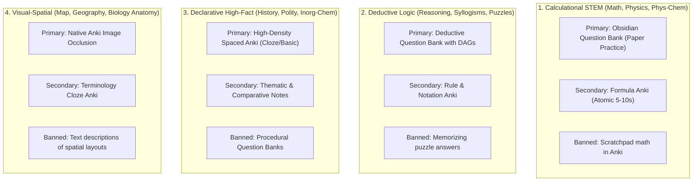

# Master Subject Pedagogical Directory (`docs/subjects/`)

**Status**: AUTHORITATIVE / FROZEN BASELINE (v1.2.0-stable)  
**Standard**: Ponytail Minimalism & Cognitive Science Alignment (ADR-25)  
**Foundation**: Dunlosky (2013), Sweller Cognitive Load Theory, Karpicke & Blunt (2011), Paivio Dual Coding Theory  

---

## 1. Overview & Architecture

StudySourceCore rejects one-size-fits-all study generation. Different educational domains possess fundamentally distinct cognitive architectures. Forcing math problems into flashcards causes **Flashcard Fatigue**, while forcing history into procedural equations produces **Meaningless Gibberish**.

This directory houses the authoritative, domain-specific pedagogical blueprints for all **9 canonical subject skills**. Each blueprint strictly enforces **"Ginti Ki Cheezein"** (2–3 essential, high-yield deliverables) while explicitly banning redundant bloat (SlideDecks, sprawling mindmaps, and scratchpad calculations in flashcards).

---

## 2. Master Subject Blueprint Index

| # | Subject File | Domain | Cognitive Archetype | The "Ginti Ki Cheezein" (Active High-Yield Weapons) | Strictly Banned Bloat |
|---|---|---|---|---|---|
| 01 | [**`01_MATH.md`**](01_MATH.md) | `Math` | Pure Quantitative STEM | • Question Bank (`Questions.md`) with 3-tier hints • Lean Formula Anki (Atomic only) | ❌ Scratchpad math in Anki ❌ Prose essay notes ❌ Mindmaps as study |
| 02 | [**`02_PHYSICS.md`**](02_PHYSICS.md) | `Physics` | Physical Modeling & Numericals | • 6-Stage Calculational Question Bank • Formula, Unit & Sign Anki • FBD & Model Reference Notes | ❌ Numerical problems in Anki ❌ Pure qualitative notes |
| 03 | [**`03_CHEMISTRY.md`**](03_CHEMISTRY.md) | `Chemistry` | Tri-Bifurcated (Phys/Inorg/Org) | • Physical: ICE Question Bank + Formula Anki • Inorganic: High-Density Spaced Anki • Organic: Reaction Roadmaps + Reagent Anki | ❌ Procedural QBank on descriptive inorganic chapters |
| 04 | [**`04_REASONING.md`**](04_REASONING.md) | `Reasoning` | Deductive Constraint Logic | • Deductive Question Bank with Logic DAGs • Notation, Rule & Fallacy Anki | ❌ Memorizing puzzle answers in Anki ❌ Narrative essay notes |
| 05 | [**`05_BIOLOGY.md`**](05_BIOLOGY.md) | `Biology` | Visual Anatomy & Declarative Terms | • Native Image Occlusion (`_IO.json`) • High-Density Cloze Anki Deck • Comparative Reference Notes | ❌ Procedural Question Banks (`NON_PROCEDURAL_DOMAIN`) |
| 06 | [**`06_HISTORY.md`**](06_HISTORY.md) | `History` | Chronological & Event Networks | • Chronological & Event Cloze Anki • Thematic Timeline Spine Notes | ❌ Procedural Question Banks ❌ 50-branch rainbow mindmaps |
| 07 | [**`07_POLITICAL_SCIENCE.md`**](07_POLITICAL_SCIENCE.md) | `Political Science` (Polity) | Constitutional & Statutory Frameworks | • Article, Amendment & Quota Cloze Anki • Comparative Institutional Tables | ❌ Rewriting Laxmikanth into prose notes ❌ Procedural Question Banks |
| 08 | [**`08_GEOGRAPHY.md`**](08_GEOGRAPHY.md) | `Geography` | Physical Geomorphology & Space | • Native Anki Image Occlusion Maps • Geomorphological Process Notes • Selective Fact Cloze Anki | ❌ Text-only border cards ❌ Procedural Question Banks |
| 09 | [**`09_MAP.md`**](09_MAP.md) | `Map` | Pure Cartography & Coordinates | • Native Anki Image Occlusion (SVG masks) • Clean Cartographic Landmark Legend | ❌ Generic synthetic text flashcards ❌ Prose lecture notes |

---

## 3. The 4 Universal Cognitive Archetypes

Every subject in human learning maps to one of four cognitive archetypes:

---

## 4. Policy Synchronization Protocol

Each subject's authoritative runtime behavior is dictated by its `skills/study-source-core/subject-skills/<Subject>/runtime-policy.json`. When orchestrating a build:
1. `subject_policy_resolver.js` loads the resolved policy.
2. The orchestrator dispatches **only** the modalities explicitly flagged `true`.
3. Any suppressed modality logs an auditable reason code (`NON_PROCEDURAL_DOMAIN`, `DESCRIPTIVE_ROTE_NO_CALCULATIONS`, etc.) in `routing_manifest.json`.
4. Zero unnecessary tokens or compute cycles are expended on banned artifacts.
